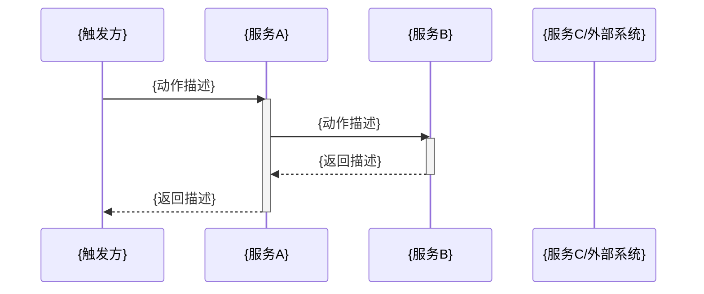

# 服务拆分：{需求标题}

- 分析日期：{YYYY-MM-DD}
- 需求来源：{TAPD ID / 用户描述}
- 基于文档：{01-需求分析.md / 用户提供描述}

---

## 一、功能清单摘要

> 从需求分析提取，作为拆分依据。

| 功能点 | 业务对象 | 业务动作 | 备注 |
|--------|---------|---------|------|
| {功能点描述} | {如：用户、订单} | {如：绑卡、扣款} | {来自需求分析 / 用户描述} |

---

## 二、全局业务流程（端到端视图）

> 描述本次需求的完整业务链路，供技术方案和编码阶段保持全局观。后续各阶段遇到跨服务设计问题时回此节定位。

### 触发点

{谁触发、何种条件触发，如"用户在 App 发起还款操作"}

### 端到端流程

```
{步骤 1}：{触发方} ──{动作}──▶ {服务A}
            └─ {服务A 内部处理描述}
{步骤 2}：{服务A} ──{动作}──▶ {服务B}
            └─ {服务B 内部处理描述}
{步骤 3}：{服务B} ──{动作}──▶ {服务C / 外部系统}
            └─ {处理结果}
...
{最终}：{结果回传或终态描述}
```

### 时序图



> 说明：alt/loop/opt 块按实际业务逻辑补充；异常分支用 `alt 异常情况` 块描述。

### 关键数据流

| 数据 | 从 | 到 | 形式 |
|------|----|----|------|
| {数据名称，如：还款请求} | {来源服务} | {目标服务} | {HTTP / RPC / MQ / DB} |

### 异常路径

| 异常场景 | 发生在哪个服务 | 处理方式 |
|---------|--------------|---------|
| {异常描述} | {服务名} | {如：返回错误码 / 补偿事务 / 告警} |

---

## 三、服务边界定义

> 各服务的职责范围和边界约束，是拆分决策的核心依据。每个涉及服务（含排除服务）写一个子节。

### {服务名称}

**本地仓库**：{本地路径} ✅ 已扫描
> 或：**本地仓库**：⚠ 未找到本地仓库，改动范围依据知识库推断，需对应服务负责人核实
> 或：**本地仓库**：— 仅调用，无需本地仓库

**职责**：{该服务负责的业务域}

**边界约束**：
- 包含：{该服务负责处理的内容}
- 不包含：{明确不属于该服务的内容，防止职责蔓延}
- 对外暴露：{HTTP API / RPC / MQ Topic}
- 依赖上游：{依赖哪些服务提供的能力，无则填"无"}

**知识库依据**：{引用的文档名称，或"项目现有模块推断"，或"知识库无依据，人工确认"}

---

### {服务名称}

**本地仓库**：{同上三选一}

**职责**：{...}

**边界约束**：
- 包含：{...}
- 不包含：{...}
- 对外暴露：{...}
- 依赖上游：{...}

**知识库依据**：{...}

---

## 三·五、功能点归属表（边界一致性校验）

> 每个功能点**有且只有一个**主责服务。此表是服务边界的摘要视图，与第三节一致，供交叉验证。

| 功能点 | 主责服务 | 协同服务 | 归属依据 |
|--------|---------|---------|---------|
| {功能点描述} | {服务名} | {服务名，无则填"-"} | {知识库文档 / 代码结构推断 / 人工确认} |

**边界冲突检测结果**：

| 检测项 | 结果 |
|--------|------|
| 存在功能点被多个服务声明为"主责" | {有/无}，{若有：列出冲突点及解决方案} |
| 存在功能点无服务认领 | {有/无}，{若有：列出遗漏点及建议归属} |
| 服务边界与全局流程时序一致 | {是/否}，{若否：列出不一致处} |

---

## 四、本次需求各服务改动清单

> 以服务为维度列出本次改动，角色为该服务在本需求中的定位。

### {服务名称}

**本地仓库**：{路径} ✅ 已扫描 / ⚠ 未找到本地仓库 / — 仅调用无需改动
**角色**：主责 / 协同改动 / 被调��方（无需改动）/ 排除

| 改动类型 | 功能描述 | 数量 |
|---------|---------|------|
| 新增接口 | {接口功能描述} | N |
| 修改接口 | {接口功能描述} | N |
| 新增 Service 方法 | {方法功能描述} | N |
| 数据库变更 | {表结构 / 字段变更描述} | N |

> ⚠ 本地仓库未找到时追加：以上改动范围为推断，请 {服务负责人} 在开发前核实。

---

### {服务名称}

**本地仓库**：{同上}
**角色**：{同上}

| 改动类型 | 功能描述 | 数量 |
|---------|---------|------|
| {类型} | {描述} | N |

---

### {服务名称}（排除）

**排除原因**：{具体说明，防止下次重复判断}

---

## 五、服务改动总览

> 一眼看清本次需求改动了哪几个服务，本地仓库是否就绪。

| 服务名称 | 本地仓库状态 | 角色 | 改动量级 | 备注 |
|---------|------------|------|---------|------|
| {服务名} | ✅ 已扫描 / ⚠ 未找到 / — 无需改动 | 主责 / 协同 / 被调用 / 排除 | 大 / 中 / 小 / 无 | {如有需人工核实的事项} |

---

## 六、知识库空白

| 功能点 | 说明 | 处理方式 |
|--------|------|---------|
| {功能点} | {知识库无依据的具体原因} | {已人工确认 / 待人工确认} |

（无空白项则填：N/A）

---

## 七、变更记录

| 日期 | 变更内容 | 操作人 |
|------|---------|--------|
| {YYYY-MM-DD} | 初始版本，已人工确认 | {操作人或 AI} |
