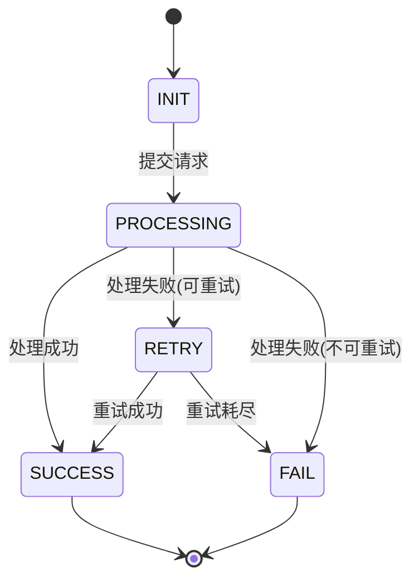

# 常用表格模板（可直接复制）

> 用途：生成技术方案时复用的表格骨架，提升一致性与可评审性。

## 输入解析要素表（推荐）

| 要素 | 你需要抽取/补齐的内容（示例） |
| --- | --- |
| 背景/痛点 | 为什么要做、现状问题、外部驱动 |
| 目标/非目标 | 2~4 条可验证目标；明确本期不做什么 |
| 功能点清单 | 功能点列表（可测试颗粒度），对应 6.x 章节拆分 |
| 核心对象/状态机 | 关键业务对象、状态枚举、状态流转与触发条件 |
| 系统范围 | 涉及服务/应用、上下游依赖、外部接口 |
| 接口清单 | API 路径/方法/鉴权/超时/幂等/错误码；以及输入输出字段 |
| MQ/事件清单 | Topic/Tag/消费组、消息体 schema、顺序/并发、重试/死信、幂等、版本兼容 |
| 数据表清单 | 新增/变更表、关键字段、唯一约束/索引、历史兼容、数据保留周期 |
| 量级与SLA | QPS/峰值、容量增长、P95/P99、SLA、失败重试预算 |
| 异常与补偿 | 可重试/不可重试、补偿触发/频率/最大次数、告警阈值 |
| 上线保障 | 监控指标、灰度策略、回滚阈值与动作、测试建议 |

## 方案选型对比表（3.1 推荐）

| 维度 | 方案 A | 方案 B | 备注/取舍 |
| --- | --- | --- | --- |
| 研发复杂度 |  |  |  |
| 测试复杂度 |  |  |  |
| 运维复杂度 |  |  |  |
| 稳定性/可用性 |  |  |  |
| 一致性保障 |  |  |  |
| 成本（资源/长期维护） |  |  |  |
| 上线风险 |  |  |  |
| 回滚难度 |  |  |  |
| 可观测性 |  |  |  |

## HTTP API 清单表

| API 描述 | 路径 | 方法 | 鉴权 | 幂等 | 超时 | 备注 |
| --- | --- | --- | --- | --- | --- | --- |
|  |  |  |  |  |  |  |

## HTTP 入参说明表

| 字段（camelCase） | 类型 | 必填 | 校验规则/约束 | 示例 | 说明 |
| --- | --- | --- | --- | --- | --- |
|  |  |  |  |  |  |

## HTTP 返回说明表

| 字段 | 类型 | 必填 | 示例 | 说明 |
| --- | --- | --- | --- | --- |
|  |  |  |  |  |

## Protobuf 接口清单表（仅用户明确要求 PB 时使用）

| 接口描述 | @path | @app_id | @request | @response | 超时 | 幂等 | 备注 |
| --- | --- | --- | --- | --- | --- | --- | --- |
|  |  |  |  |  |  |  |  |

## Protobuf 消息字段表（Request/Response）

| Message | 字段名（snake_case） | 类型 | 字段号 | 必填 | 示例 | 说明 |
| --- | --- | --- | --- | --- | --- | --- |
| Request | basic | RequestBasic | 1 | 是 |  | 必填基础字段 |
| Request |  |  | 2 |  |  |  |
| Response | basic | ResponseBasic | 1 | 是 |  | 必填基础字段 |
| Response |  |  | 2 |  |  |  |

## Protobuf 协议代码格式示例（6.x.5 第一层参考）

> 协议代码须与下方字段说明表字段顺序、名称、类型完全一致。字段行按列对齐。

```protobuf
message CreateRefundRequest {
  optional  RequestBasic  basic          = 1;  // 必填基础字段
  optional  string        order_no       = 2;  // 原订单号
  optional  string        refund_reason  = 3;  // 退款原因
  optional  int64         refund_amount  = 4;  // 退款金额(分)
  optional  string        operator_id    = 5;  // 操作人 ID
}

message CreateRefundResponse {
  optional  ResponseBasic  basic       = 1;  // 必填基础字段（code/msg/scode/time 由此承载，不另加）
  optional  string         refund_no   = 2;  // 退款单号
  optional  string         status      = 3;  // 退款状态
  // 注意：错误码(scode)和错误描述(msg)由 ResponseBasic 承载，Response 中不新增 error_code/error_msg 字段
}
```

> **对齐规则**：`{修饰符}`（补齐到 10 字符列宽）`{类型}`（补齐到最长类型 + 2 空格）`{字段名}`（补齐到最长字段名 + 2 空格）`= {序号};`  `// {注释}`
> **字段顺序**：须与 Protobuf 消息字段表中的行顺序完全一致。
> **PB 响应约束**：Response message 仅含 `basic`（ResponseBasic）+ 业务数据字段。`ResponseBasic` 已承载 `code`（状态码, 0=成功/99=失败）、`msg`（错误描述）、`scode`（业务错误码）、`time`（时间戳），Response 中**不得**另加 error_code/error_msg/code/msg 字段。错误码表中的 code/msg 对应的是 `ResponseBasic.scode` / `ResponseBasic.msg` 的取值。

## REST 接口协议代码格式示例（6.x.5 第一层参考）

> 请求/响应 JSON 示例须与下方字段说明表字段顺序、名称、类型完全一致。

**请求示例**（POST /api/v1/refunds）：

```json
{
  "orderNo": "202501010001",       // string, 原订单号
  "refundReason": "用户申请退款",    // string, 退款原因
  "refundAmount": 1000,            // long, 退款金额(分)
  "operatorId": "OP001"            // string, 操作人 ID
}
```

**响应示例**：

```json
{
  "code": "000000",                // string, 业务状态码
  "message": "success",            // string, 状态描述
  "data": {
    "refundNo": "RF202501010001",  // string, 退款单号
    "status": "INIT"               // string, 退款状态
  }
}
```

> **格式规则**：2 空格缩进；字段值后以 `// {type}, {说明}` 行尾注释标注类型和含义；字段顺序须与 HTTP 入参/返回说明表一致。

## 错误码表

| code（字符串） | msg（字符串） | 触发条件 | 调用方处理建议 |
| --- | --- | --- | --- |
|  |  |  |  |

## 幂等键说明表（HTTP / 事件均可复用）

| 幂等键来源 | 组成字段 | 去重窗口 | 幂等落点（DB/Redis） | 冲突处理策略 |
| --- | --- | --- | --- | --- |
| 业务唯一标识（优先） | orderId / bizId | 按业务 | DB 唯一索引 / 幂等记录表 | 返回原单据（DUPLICATE_REQUEST） |
| 请求头（无业务标识时） | X-Request-Id | 24h（建议） | Redis SETNX + TTL | 返回原单据（DUPLICATE_REQUEST） |

## MQ/事件清单表

| 场景 | Topic | Tag（如有） | 生产者 | 消费者/消费组 | 顺序 | 并发 | 重试/死信 | 幂等键 | 备注 |
| --- | --- | --- | --- | --- | --- | --- | --- | --- | --- |
|  |  |  |  |  |  |  |  |  |  |

## 消息体 schema 表（JSON 示例）

| 字段 | 类型 | 必填 | 示例 | 说明 |
| --- | --- | --- | --- | --- |
|  |  |  |  |  |

## 数据库表清单

| 表名 | 用途 | 新增/变更 | 主键/唯一约束 | 关键索引 | 数据保留/归档 |
| --- | --- | --- | --- | --- | --- |
|  |  |  |  |  |  |

## 索引清单（含自检）

| 表名 | 索引名 | 类型（唯一/普通/联合） | 字段顺序 | 服务的查询场景 | 备注（数量自检/原因） |
| --- | --- | --- | --- | --- | --- |
|  |  |  |  |  |  |

## 监控指标清单（8.3 推荐）

> 技术指标为通用项；业务指标应结合本方案功能点按需填写，下表示例仅供参考。

| 指标大类 | 指标名 | 口径/维度 | 阈值建议 | 告警级别 | 处理动作 |
| --- | --- | --- | --- | --- | --- |
| 技术-接口 | 接口成功率 | 服务/API/错误码 |  | P1 |  |
| 技术-接口 | P99 延迟 | 服务/API |  | P2 |  |
| 技术-DB | 慢查询数 | 表/SQL |  | P2 |  |
| 技术-MQ | 消费 lag | Topic/消费组 |  | P2 |  |
| 业务 | 核心链路成功率 | 业务场景/渠道 |  | P1 |  |
| 业务 | 状态流转异常率 | 业务对象/状态跳转 |  | P2 |  |
| 业务 | 业务量波动 | 场景/渠道/时段 |  | P2 |  |
| 业务 | 资金对账差异 | 渠道/账户 | > 0 | P1 |  |

## 节点链 ASCII 图示例（6.1.4 流程编排设计推荐）

> 用于展示流程编排的完整节点链，包含同步/异步标注、分支路由、成功/失败路径和补偿逻辑。
> 根据实际业务复杂度选择合适的模式，可组合使用。

**模式一：线性链（无分支）**

```
/**
 * 开始 → [同步]参数校验 → [同步]构建订单 → [异步]渠道调用 ─ 成功 → [同步]更新状态 → 结束
 *                                              │
 *                                              └─ 失败 → [同步]补偿回滚 → 异常结束
 */
```

**模式二：分支路由链（按类型分流）**

```
/**
 * 开始 → [同步]参数校验 → [同步]构建订单 → [同步]分流节点 ──┬─ 类型A → [异步]处理A ─── 成功 → [同步]提交 → 结束
 *                                                     │                  │
 *                                                     │                  └─ 失败 → [同步]回滚 → 异常结束
 *                                                     │
 *                                                     ├─ 类型B → [异步]处理B ─── 成功 → [同步]提交 → 结束
 *                                                     │                  │
 *                                                     │                  └─ 失败 → [同步]回滚 → 异常结束
 *                                                     │
 *                                                     └─ 类型C → [异步]处理C1 ─── 成功 → [异步]处理C2 ─── 成功 → [同步]提交 → 结束
 *                                                                    │                        │
 *                                                                    │                        └─ 失败 → [同步]回滚 → 异常结束
 *                                                                    └─ 失败 → [同步]回滚 → 异常结束
 */
```

**模式三：条件分支链（按状态/结果分流）**

```
/**
 * 开始 → [同步]预处理 → [异步]外部调用 ──┬─ 成功 → [同步]后处理 → 结束
 *                                     │
 *                                     ├─ 部分成功 → [同步]差异处理 → [异步]补单 → 结束
 *                                     │
 *                                     └─ 失败 ──┬─ 可重试 → [异步]重试调用 → (回到外部调用)
 *                                               │
 *                                               └─ 不可重试 → [同步]补偿 → 异常结束
 */
```

> **标注规则**：
> - 每行以 ` * ` 开头，保持注释块格式对齐
> - `[同步]` / `[异步]` 标注节点执行方式
> - `→` 表示正常流转，`─── 成功 →` / `─── 失败 →` 或 `─ 成功 →` / `─ 失败 →` 标注条件分支
> - 分支用 `┬─` `├─` `└─` 连接，竖线 `│` 严格纵向对齐
> - 补偿/回滚路径必须画出，不可省略

## 状态流转图（6.1.4 推荐，Mermaid stateDiagram-v2）



> **转移标注格式**：`触发事件`
> 未在图中出现的 (当前状态, 触发事件) 组合视为非法跳转，应拒绝并告警。

## 定时任务/Job 设计表（4.1 推荐）

| 维度 | 内容 |
| --- | --- |
| 任务名称 |  |
| 触发方式 | cron 表达式 / 事件触发 / 手动触发 |
| 执行频率 | 如：每 5 分钟 / 每日 02:00 |
| 数据范围 | 扫描哪张表、筛选条件（状态 + 时间窗口） |
| 批次大小 | 单次拉取条数、分页策略（游标/LIMIT OFFSET） |
| 并发控制 | 单机互斥 / 集群分片 / 分布式锁 |
| 幂等性 | 重复执行是否安全、幂等判断依据 |
| 失败处理 | 单条失败是否跳过继续 / 中断整批；重试策略；告警阈值 |
| 执行耗时预估 | 单批耗时 × 预估总批次数 |
| 监控指标 | 执行成功率、耗时、处理条数、失败条数 |

## 外部依赖调用规格表（8.1 推荐）

| 依赖系统 | 接口/能力 | 调用方向 | 强/弱依赖 | 超时(ms) | 重试策略 | 熔断条件 | 降级行为 |
| --- | --- | --- | --- | --- | --- | --- | --- |
|  |  |  |  | connect: / read: | 次数/间隔/退避 | 错误率 > X% 持续 Ys | 缓存兜底 / 默认值 / 快速失败 |

## 容量评估表（8.2 推荐）

| 评估维度 | 当前值 | 预期峰值 | 资源预算 | 保护策略 | 备注 |
| --- | --- | --- | --- | --- | --- |
| QPS（读） |  |  |  | 限流/缓存 |  |
| QPS（写） |  |  |  | 限流/排队 |  |
| 数据量（日增/总量） |  |  |  | 归档/分库分表 |  |
| 连接数（DB/Redis/MQ） |  |  |  | 连接池上限 |  |
| 带宽/消息吞吐 |  |  |  | 压缩/批量 |  |

## 灰度方案表（8.4 推荐）

| 阶段 | 灰度范围 | 持续时长 | 放量条件 | 回滚条件 | 回滚动作 |
| --- | --- | --- | --- | --- | --- |
| 小流量验证 | 单机构/单渠道/白名单 | ≥ 15 min | 必看指标连续稳定，无新增 P1 告警 | 成功率 < ___% / P99 > ___ms | 关开关/切流量 |
| 扩大灰度 | 部分机构/部分渠道 | ≥ 30 min | 同上 | 同上 | 版本回退 |
| 全量发布 | 全量 | 持续观察 T+1 | 同上 + 对账无差异 | 业务差异 > 0 | 数据补偿 + 版本回退 |

## 配置项清单（8.8 推荐）

| 配置键 | 含义 | 默认值 | 可选值/范围 | 影响范围 | 是否热生效 | 备注 |
| --- | --- | --- | --- | --- | --- | --- |
|  |  |  |  |  |  |  |


