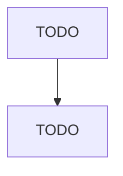
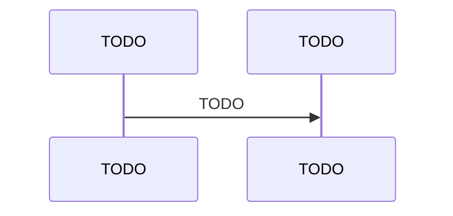

## 技术方案模板（骨架版）

> 用途：生成技术方案正文时的章节骨架 + 写作提示。所有 `> 提示：` 行仅供写作参考，**不要**输出到最终方案中。
> 示例（Mermaid 图、DDL 等）见 `../references/examples/技术方案模板-示例.md`。

### 0. 方案基本信息（建议保留）

> 提示：版本记录每次变更追加新行，保留完整历史。评审参与人应覆盖产品、研发、测试、运维等相关角色，确保方案被充分评审。

- 方案标题：`[业务子模块]-XX功能设计`
- 方案负责人：
- 日期：
- 评审参与人（产品/研发/测试/运维/风控等）：
- 关联需求/Story 链接：
- 版本记录：`V1.0 / 作者 / 日期 / 变更摘要`（迭代时追加新行，保留历史记录）

---

### 1. 背景与目标

> 提示：明确「为什么要做」「解决什么痛点」「本期不解决什么」。目标用 2~4 条可验证目标（尽量量化，如"支持峰值 QPS 1000""消息到达率 ≥ 99.9%""P99 延迟 < 500ms"）。非目标同等重要——明确写出本期不做的事项，避免评审时范围发散。

- 背景：
- 目标：
- 非目标：

---

### 2. 功能点概述

> 提示：用列表列清楚交付的功能颗粒度，便于拆分与测试。每个功能点标注类型标签：
> - **[核心]**：影响主链路/资金/一致性/核心状态机/补偿逻辑 → 第 6 章必须有 flowchart
> - **[跨系统]**：涉及 ≥2 个系统/服务/组件交互 → 第 6 章必须有 sequenceDiagram
> - 一个功能点可同时具备两个标签
> - 若为性能/稳定性/重构等技术改造，用「能力视角」描述（如"支持批量补偿"而非"重构补偿模块"）。

- 功能点 1 **[核心][跨系统]**：
- 功能点 2 **[核心]**：
- 功能点 3：

---

### 3. 技术分析与方案选型

> 提示：从技术视角解析需求，先列约束与难点，再给出整体思路，为下文方案选型铺垫。

- 业务侧约束：计费规则、资金路径、风控策略、合规要求等
- 技术侧约束：存量数据兼容；调用量级/QPS/峰值；可用性/一致性/延迟取舍（CAP）
- 核心技术难点：

**总体解决思路**（3~5 句概述，承上启下，引出 3.1 方案选型）：

#### 3.1 方案选型与对比（推荐）

> 提示：至少给出 2 个候选方案，明确取舍理由，避免"只写一个方案"导致评审缺乏对比基线。

- 候选方案：
  - 方案 A：
  - 方案 B：
  - （可选）方案 C：
- 对比维度与结论（建议用表格给出，复用「方案选型对比表」）：
  - 结论：选择方案 X，原因（3~5 条）

---

### 4. 涉及的服务 / 系统

> 提示：用系统视角罗列改动范围，便于评估联调与风险。涉及 ≥3 个服务/组件时，**必须**补一张系统架构总览图（C4 Context 或简化版），标注本次改动的服务（加粗/高亮）与数据流向。

- 服务/应用：
- 任务/定时器/消息：
- 管理后台/运营工具（如有）：

#### 4.1 定时任务/Job 设计（如涉及）

> 若本需求不涉及，写"本需求不涉及"。
> 提示：补偿、对账、批处理等任务是很多系统的核心组件，需要写清楚到开发可编码的程度。每个定时任务复用「定时任务/Job 设计表」，逐项填写（任务名称、触发方式、数据范围、批次大小、并发控制、幂等性、失败处理、耗时预估、监控指标）。

---

### 5. 数据库设计（如涉及）

> 若本需求不涉及，写"本需求不涉及"。
> 提示：数据库设计是全局设计，SQL 脚本建议统一放在本节，避免分散。

#### 5.1 数据库 ER 图与表设计

> 提示：所有表结构须通过 `scripts/call_kb.py` 检索或直接 Read 知识库（`kb_root`）中的数据库规范（字段类型、必需字段、表属性、索引等）和术语命名规范（表名、列名及业务词）对齐。须满足本模板 **附录「规范合规自检」** 中 **数据库规范**、**数据库字段命名** 两项。**涉及数据库表时，ER 图为必须交付物**，须使用 Mermaid `erDiagram` 绘制，展示所有涉及表的实体关系、核心字段（PK/FK/关键业务字段）与关联关系（1:1/1:N/M:N）。ER 图示例见 `../references/examples/技术方案模板-示例.md`。

##### 5.1.1 数据模型设计交付物

- **ER 图**（**必须**）：使用 Mermaid `erDiagram` 绘制，覆盖所有涉及表、核心字段与表间关系
- 表清单：表名、用途、是否新增/变更
- 字段说明：字段含义、类型、可空、默认值、约束；关键字段是否参与幂等/对账/查询
- 索引说明：索引名、字段顺序、服务的查询/排序/去重场景
  - 索引数量自检：单表索引数 ≤ 5；单索引字段数 ≤ 5（写出实际数量与原因）
- 分库分表/归档（如适用）：路由键、拆分策略、归档策略、历史数据兼容

##### 5.1.2 DDL / DML 脚本（如涉及）

- DDL：建表/改表/索引脚本（需包含表属性与注释）
- DML：初始化/修复/回填脚本（说明幂等性与可重复执行）
- 执行顺序：多库多环境执行顺序（如：先灰度库后全量库）
- 回滚/补偿：DDL 是否可回滚；DML 如何回滚或补偿

---

### 6. 功能设计（按功能点拆分）

> 提示：按「主流程 + 子章节」展开，每节聚焦一个功能点。子章节优先级：
> - **必须**：6.x.1 功能说明、6.x.2 流程图（核心功能点）、6.x.3 时序图（跨系统功能点）、6.x.4 状态机、事务与流程编排设计、6.x.6 幂等与异常补偿
> - **按需**：6.x.5 接口设计（有新接口时）、6.x.7 数据模型变更（有表变更时）、6.x.8 兼容性（有存量兼容时）、6.x.9 缓存（有缓存设计时）、6.x.10 特化说明（与第 8 章有差异时）
> - 不涉及的子章节保留标题，写"本需求不涉及"

#### 6.1 功能设计（功能点 1）

##### 6.1.1 功能说明与边界

> 提示：用 5~10 行把这个功能点讲清楚，评审才能快速对齐语义。

- 一句话描述：
- 触发方式：API / MQ 事件 / 定时任务 / 后台操作
- 输入与输出：
- 前置条件与约束：
- 不在本功能点解决的范围：

##### 6.1.2 流程图（业务判断/状态流转）

> 提示：适合表达规则、分支与状态机。建议覆盖关键分支与补偿触发点。核心功能点必须有 flowchart。

##### 6.1.3 时序图（系统交互/关键写入点）

> 提示：标注关键写入点、外部依赖、失败重试/补偿触发位置。跨系统交互功能点必须有 sequenceDiagram。
> 若本功能点仅调用已有接口（不新增、不变更跨系统交互），时序图中以单行标注该调用即可，不需展开完整交互细节。若本功能点无任何跨系统交互，写"本需求不涉及"。

##### 6.1.4 状态机、事务与流程编排设计

> 提示：每个状态跳转须写明触发事件；前置校验、执行动作、并发控制等在正文中描述。事务边界须标注哪些操作必须同事务、哪些在事务提交后执行；并发场景须写明锁类型和冲突处理方式。

- **状态流转图**（必须用 Mermaid `stateDiagram-v2`）：复用「状态流转图」模板
  - 每条转移标注：`触发事件`
  - 未在图中出现的 (当前状态, 触发事件) 组合视为非法跳转，应拒绝并告警
- **事务边界**（必须标注）：
  - 必须同事务的操作（如「落库 + 扣减」原子性）：
  - 事务外操作（如「发 MQ」在事务提交后）：
  - 分布式一致性策略（本地消息表 / TCC / Saga / 最终一致）：
- **并发控制**（有并发写入场景时必须标注）：
  - 并发写入点：
  - 加锁策略（乐观锁 version / 悲观锁 SELECT FOR UPDATE / 分布式锁）：
  - 冲突处理（重试 / 报错 / 合并）：
- **流程编排设计**（涉及流程引擎 / Saga / Pipeline 等编排模式时必须，不涉及写"不涉及"）：
  > 提示：当功能点涉及多步骤异步编排时，须详细设计流程类和各节点逻辑，写到开发可直接编码的程度。
  - **流程类设计**：流程类名、继承关系、类型枚举/路由映射、参考流程
  - **节点链设计**（必须有 ASCII 图，格式参考「技术方案-表格模板.md」节点链 ASCII 图示例）：完整节点链（标注 `[同步]`/`[异步]`）、成功/失败分支路由、补偿/回滚路径
  - **节点总览表**：节点名称 / 标识 / 同步或异步 / 复用或新增 / 主要作用
  - **各节点详细设计**（每个节点须包含）：
    - 执行逻辑：输入来源（从上下文读哪些字段）、核心处理步骤、下游调用（类名+方法名+超时）、输出（写回哪些字段）
    - 回调逻辑（仅异步节点）：幂等检查、状态映射、成功/失败路由
    - 补偿逻辑：终态处理、重试策略、异常兜底
  - **流程上下文数据流**（表格）：字段 Key / 写入方 / 读取节点 / 类型 / 说明
  - **异步回调路由**（如有异步节点）：回调入口、请求结构、状态映射
  - **流程构建伪代码**（推荐）：节点链组装逻辑

##### 6.1.5 接口设计

> 提示：基于前序流程图/时序图/状态机，定义接口的完整设计。接口按变更类型分三类处理：
> - **新增接口**：完整输出下方两层设计（协议代码 + 字段说明表 + 错误码表）
> - **变更接口**（扩展已有接口）：仅输出变更增量——标注「扩展已有接口 {名称}」，列出新增/修改的字段和新增错误码，不重复已有字段
> - **仅调用接口**（本功能点不修改）：写"本功能点仅调用已有接口 {名称}，不涉及接口变更"
> 若本功能点不涉及任何接口（既无新增也无变更也无调用），写"本需求不涉及"。
> 新增接口的设计须包含以下两层，由粗到细：

> **第一层 — 接口协议代码**（新增接口必须）：
> 提供实际可用的协议定义代码（非伪代码），开发可直接参照或复制：
> - Protobuf 接口：输出完整的 `message` 定义，字段注释写在行尾，字段顺序和命名须与第二层字段说明表一致
> - HTTP/REST 接口：输出请求/响应 JSON Schema 示例或等效代码
> - MQ 消息：输出消息体 JSON Schema 或 Proto 定义
> - 响应结构须以知识库中检索到的公共响应基类为准，不得在响应消息中重复定义已由基类承载的字段（如错误码、错误描述）
> - 协议代码格式须遵循「技术方案-表格模板.md」中的格式示例：Proto 按列对齐、REST 按 2 空格缩进 + 行尾类型注释

> **第二层 — 字段说明与错误码**（补充参考）：
> - 字段说明表：复用现有表格模板（HTTP API / Protobuf 消息字段表），作为协议代码的结构化补充，须与第一层协议代码中的字段顺序、命名、类型完全一致
> - 错误码表：列出本接口涉及的业务错误码，每条包含 code（字符串）和 msg（字符串）及处理建议
>
> **格式对齐规则**：
> - 协议代码与字段说明表互为镜像：先写协议代码，再从协议代码推导字段说明表，确保字段顺序、名称、类型一一对应
> - 错误码表中的 code 值须与协议代码中实际使用/抛出的错误码一致

- 公共能力/公共 API（如有）：
- HTTP API（如有）：复用「HTTP API 清单表 / 入参说明表 / 返回说明表 / 错误码表 / 幂等键说明表」；**接口规范**、**路径命名**、**接口字段命名**须通过 `scripts/call_kb.py` 检索或直接 Read 知识库（`kb_root`）中的接口规范与术语命名规范条文为准；涉及公共组件的接口，出入参须同时对齐组件文档规范
- MQ/事件（如有）：复用「MQ/事件清单表 / 消息体 schema 表」；消息体**字段名**须通过知识库检索术语规范与接口规范条文对齐
- RPC/Protobuf（如有）：复用「Protobuf 接口清单表 / 消息字段表」；**接口规范**、**字段命名**须通过知识库检索对应规范条文对齐（勿绑固定文件名或章号）

##### 6.1.6 幂等与异常补偿

> 提示：幂等键须写明构成字段、校验位置和去重窗口；异常补偿须区分可重试与不可重试，写明触发条件和最大重试次数。

- **幂等点设计**：幂等键构成；校验位置；记录存储介质；去重窗口；冲突返回策略
- **异常处理与补偿**：可重试 vs 不可重试；补偿触发条件/频率/最大次数；告警阈值

##### 6.1.7 数据模型变更点（如涉及）

> 提示：数据库全局设计见第 5 章。本节仅描述本功能点新增/变更的数据对象。若本需求不涉及，写"本需求不涉及"。
> 仅查询已有表（不新增/不变更字段或索引）不属于数据模型变更，应写"本需求不涉及"。

- 涉及表与变更摘要：
- 新增字段/索引用途与影响：

##### 6.1.8 兼容性设计（如涉及）

> 提示：关注增量上线、老数据/老调用方兼容，覆盖 API、缓存结构、消息协议等维度。若本需求不涉及，写"本需求不涉及"。

- API 兼容：
- 缓存兼容：
- 消息兼容：
- 灰度开关：

##### 6.1.9 缓存设计（如涉及）

> 若本需求不涉及，写"本需求不涉及"。

- Key 设计：模板/组成/命名；热点 Key 分散方案
- TTL：时长依据；是否使用随机 TTL 防雪崩
- 一致性/失效：Cache Aside / Read-Through / Write-Through

##### 6.1.10 本功能点特化说明（如涉及）

> 提示：第 8 章为全局要求，本节仅在本功能点存在差异化时补充，避免重复。若本需求不涉及，写"本需求不涉及"。

- 外部依赖差异：
- 容量/性能差异：
- 监控/告警差异：
- 上线观察口径差异：
- 灰度/回滚差异：
- 权限/安全/审计差异：

---

### 7. 辅助功能设计（按需）

> 提示：功能点数量较多时，第 6 章放主流程/核心功能点，第 7 章放辅助功能点（如管理后台、查询接口、配置管理等）。拆分原则：
> - **第 6 章**：主链路功能（如申请、审批、支付）— 需要完整的 6.x.1~6.x.10 子结构
> - **第 7 章**：辅助/支撑功能（如查询、导出、后台操作）— 沿用 6.x 结构，按下方裁剪规则输出
> - 如果只有 1~2 个功能点，全部放在第 6 章即可（6.1、6.2），第 7 章写"本需求不涉及"

#### 7.1 功能设计（功能点 N）

> 辅助功能点裁剪规则：
> - **必须保留**：7.x.1 功能说明与边界、7.x.5 对外契约（有接口时）、7.x.6 幂等与异常补偿（有写入时）
> - **按需保留**：7.x.2 流程图（有复杂分支时）、7.x.3 时序图（跨系统时）、7.x.4 状态机与事务设计（有状态流转时）
> - **可省略**：7.x.7~7.x.10（数据模型变更、兼容性、缓存、特化说明），除非本功能点确实涉及
> - 不涉及的子节保留标题，写"本需求不涉及"

---

### 8. 方案级非功能与上线保障（全局）

> 提示：本章内容对整个方案生效；若某功能点有差异，请写在对应功能点的「6.x.10 本功能点特化说明」里。

#### 8.1 外部依赖点

> 提示：写到开发能直接配置的程度。复用「外部依赖调用规格表」。

- 依赖系统/接口（强/弱依赖）：
- SLA / 超时（connect/read，具体毫秒值）：
- 重试策略（次数/间隔/退避，仅超时/网络异常重试）：
- 熔断条件（错误率 > X% 持续 Ys）：
- 降级行为（具体到代码层面：缓存兜底 / 默认值 / 快速失败 / 异步补偿）：
- 联调点：

#### 8.2 容量评估 / 性能预算（推荐）

> 提示：评审阶段给出"量级假设 + 资源预算 + 保护策略"，上线更稳。

- 量级假设：
- 性能目标：
- 关键资源与预算：
- 保护策略：

#### 8.3 监控与告警（推荐）

> 提示：写到"能落地配置"的程度。复用「监控指标清单」。业务监控指标应结合本方案实际功能点设计，覆盖核心业务流程的关键环节（如成功率、转化率、金额一致性等），而非仅关注技术层面。

- 技术指标（至少覆盖：接口成功率/RT/错误码分布/DB 慢查询/MQ lag/缓存命中率）：
- 业务指标（结合本方案功能点，如：核心链路成功率、业务状态流转异常率、资金对账差异、业务量波动等）：
- 上报维度（至少覆盖：服务/API/错误码/渠道/Topic/状态/业务场景）：
- 告警策略（P1/P2/P3 分级，含业务告警）：
  - P1（立即处理）：资金异常/核心链路中断/成功率骤降
  - P2（30 分钟内响应）：非核心链路异常/业务量异常波动/状态流转异常
  - P3（下个工作日）：性能劣化/非关键指标偏离基线
- 可观测性落点（trace、查询/排查入口）：

#### 8.4 灰度方案（必填）

> 提示：先定灰度策略，再定观察方案。写到可执行，所有阈值必须填具体数值（不留空白），填写时参考 8.2 的性能目标和 8.3 的监控指标。

- 灰度开关/策略：维度（机构/渠道/场景/用户）；步骤（小流量 → 部分 → 全量）
- 双写/对账（如有）：
- 发布与灰度步骤：预发布检查 → 灰度发布 → 小流量验证 → 扩大灰度 → 全量
- 放量条件：所有必看指标连续稳定 ______ 分钟，且无新增 P1 告警
- 回滚条件：成功率 < ______ / P99 > ______ / MQ lag > ______ / 业务差异 > ______
- 回滚动作：优先止血（关开关/切流量）→ 版本回退 → 数据补偿/修复 → 回滚校验

#### 8.5 上线数据观察方案（推荐）

> 提示：基于 8.4 灰度策略，定义每个阶段"看什么数据、怎么看、异常怎么处理"。观察口径应与 8.3 监控指标对齐。

- 观察目标：
- 观察窗口：T+0（0~30min）/ T+1（2~4h）/ T+2（24h）
- 观察口径与维度：
- 异常判定与处置：

#### 8.6 影响范围及测试建议（必填）

> 提示：影响范围应覆盖上下游系统；回归清单基于各功能点的设计内容汇总，补充跨功能点的集成测试场景。

- 影响范围：
- 回归清单：
- 数据核对建议：

#### 8.7 权限 / 安全 / 审计（如涉及）

> 若本需求不涉及，写"本需求不涉及"。
> 提示：常见关注点——权限控制（接口/数据/操作级别的鉴权方式）、数据安全（敏感字段脱敏规则、传输加密、存储加密）、审计日志（关键操作的审计记录内容与保留周期）。

- 权限控制：
- 数据安全：
- 审计与追踪：

#### 8.8 配置项清单（推荐）

> 提示：汇总所有需要在配置中心新增或变更的配置项，避免上线时遗漏。复用「配置项清单」。灰度开关也应汇总到此处。

- 配置项列表（配置键 / 含义 / 默认值 / 可选值 / 影响范围 / 是否热生效）：

---

### 附录：规范合规自检（知识库强制对齐）

> 下列项须以 **`scripts/call_kb.py`**（`search` / `read`）或直接 Read 从本地知识库（`kb_root`，路径由 `scripts/kb.config.json` 配置）拉取的条文为**唯一**依据；**禁止**凭记忆、口语习惯或未检索条文自行定义命名或规则。详见本 skill 的 `SKILL.md`「【强制】知识库为唯一事实来源」。

交付前逐项勾选（与条文不一致处须改稿或注明依据）：

- [ ] **接口规范**：PB/REST/HTTP 等接口定义、协议与错误码等，已与知识库中接口规范检索命中条文对齐
- [ ] **数据库规范**：建表、改表、索引、字段类型、DDL 书写等，已与知识库中数据库规范检索命中条文对齐
- [ ] **接口字段命名**：PB/REST/MQ 等消息体字段名、参数名，已与知识库中术语命名规范与接口规范中命名相关条文对齐
- [ ] **路径命名**：HTTP URL 路径段、资源路径等，已与知识库中接口规范（REST/URL 相关检索）及术语规范**共同**对齐
- [ ] **数据库字段命名**：表名、列名及业务词，已与知识库中术语命名规范与数据库规范中命名相关条文对齐
- [ ] **公共组件接口**：涉及公共组件的接口，出入参结构与字段已按知识库中组件文档规范对齐

