## 技术方案模板（示例集）

> 用途：为骨架各章节提供参考示例（Mermaid 图、DDL、响应体等）。
> 章节结构与写作提示见 `../../assets/技术方案模板-骨架.md`。

---

### 流程图示例（6.1.2）

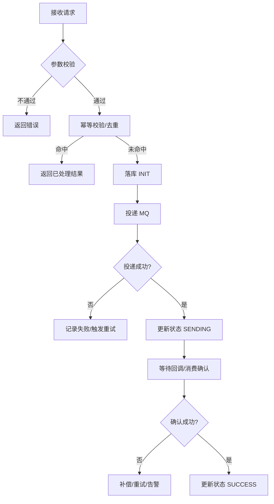

---

### 时序图示例（6.1.3）

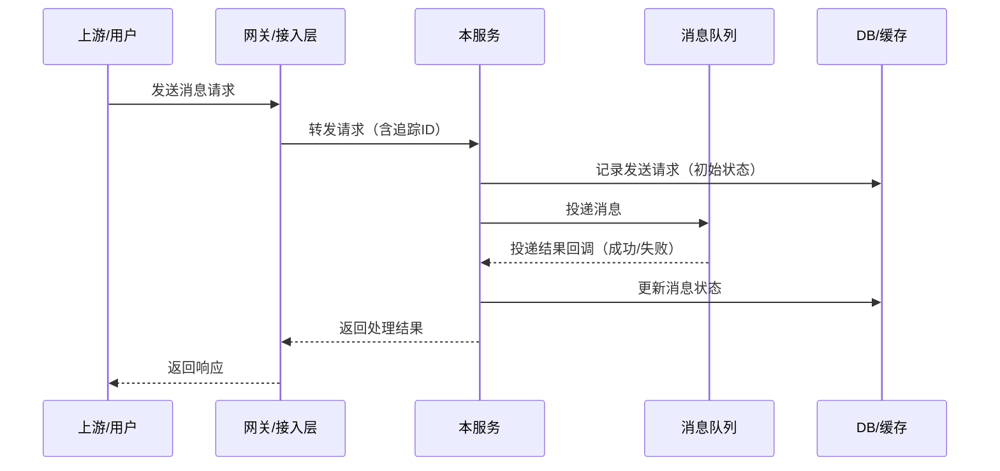

---

### 数据库 ER 图示例（5.1.1）

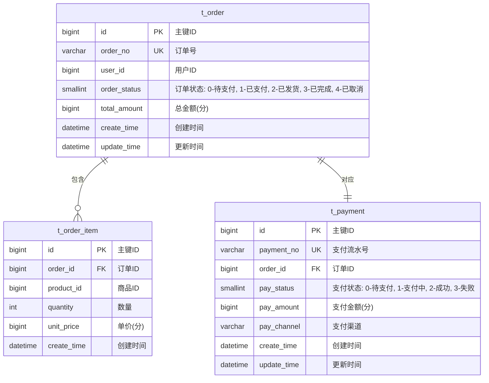

> **ER 图绘制要点**：
> - 使用 `||--||`（1:1）、`||--o{`（1:N）、`}o--o{`（M:N）标注关联基数
> - 每个实体列出 PK、FK、UK 和核心业务字段，辅助字段（如 is_deleted）可省略
> - 字段注释写明含义，枚举值写明各取值含义
> - 表名前缀与命名风格以 MCP 拉取的 `mysql_database_specification` 和 `terminology_naming_specification` 为准，本示例仅供格式参考

---

### 建表语句示例（5.1.2）

```sql
CREATE TABLE `t_xxx` (
  `id` BIGINT UNSIGNED NOT NULL AUTO_INCREMENT COMMENT '主键ID',
  `biz_id` VARCHAR(64) NOT NULL COMMENT '业务唯一ID',
  `xxx_status` SMALLINT NOT NULL DEFAULT 0 COMMENT '状态: 0-初始化, 1-处理中, 2-成功, 3-失败',
  `xxx_amount` BIGINT NOT NULL COMMENT '金额(分)',
  `is_deleted` SMALLINT NOT NULL DEFAULT 0 COMMENT '是否删除: 0-未删除, 1-已删除',
  `create_time` DATETIME NOT NULL DEFAULT CURRENT_TIMESTAMP COMMENT '创建时间',
  `update_time` DATETIME NOT NULL DEFAULT CURRENT_TIMESTAMP ON UPDATE CURRENT_TIMESTAMP COMMENT '更新时间',
  PRIMARY KEY (`id`),
  UNIQUE KEY `uniq_t_xxx_biz_id` (`biz_id`),
  KEY `idx_t_xxx_xxx_status` (`xxx_status`)
) ENGINE=InnoDB DEFAULT CHARSET=utf8mb4 COLLATE=utf8mb4_general_ci COMMENT='XXX表';
```

---

### 状态流转图示例（6.1.4）

> 使用 Mermaid `stateDiagram-v2`，每条转移标注格式：`触发事件`。
> 骨架见「技术方案-表格模板.md → 状态流转图」。

#### 单对象示例：退款单状态流转图

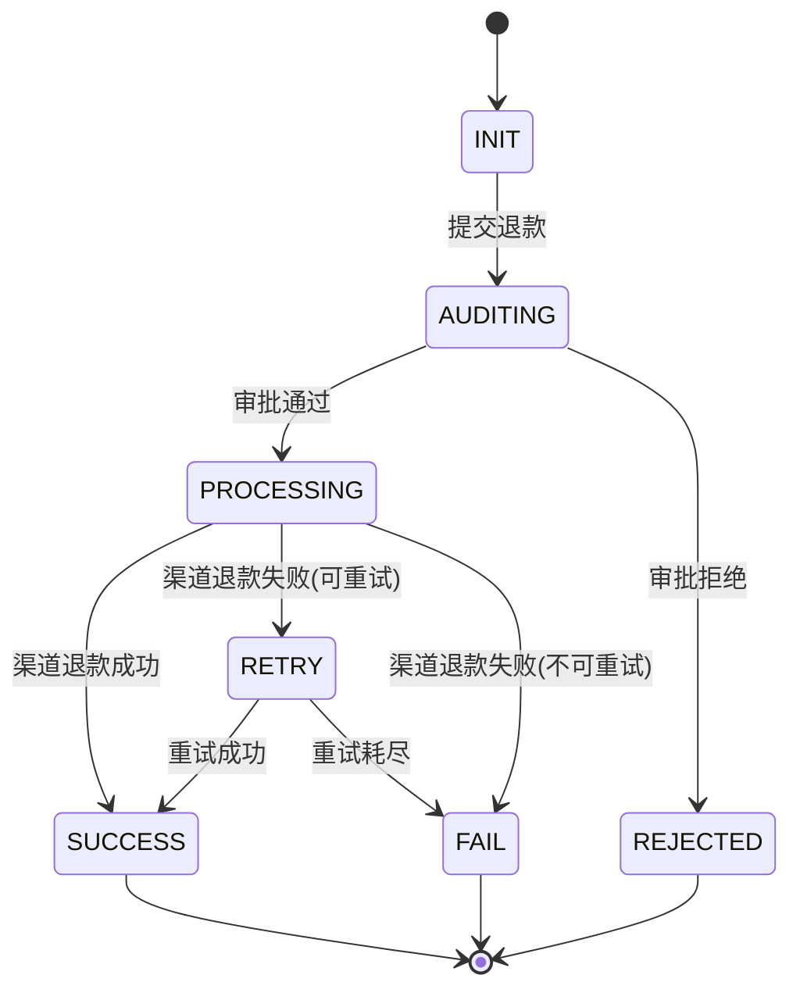

#### 多对象示例：退款场景（订单表 + 退款单表）

> 一个功能点涉及多张表的状态变更时，**每个业务对象画独立的状态流转图**，再用文字说明对象间的联动关系。

**1）订单状态流转图**

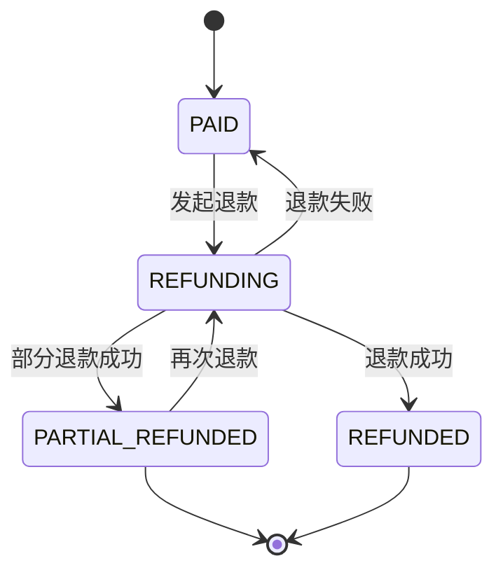

**2）退款单状态流转图**

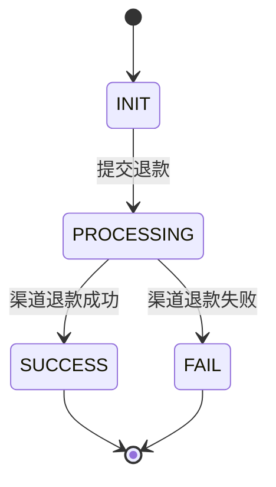

**3）状态联动图**

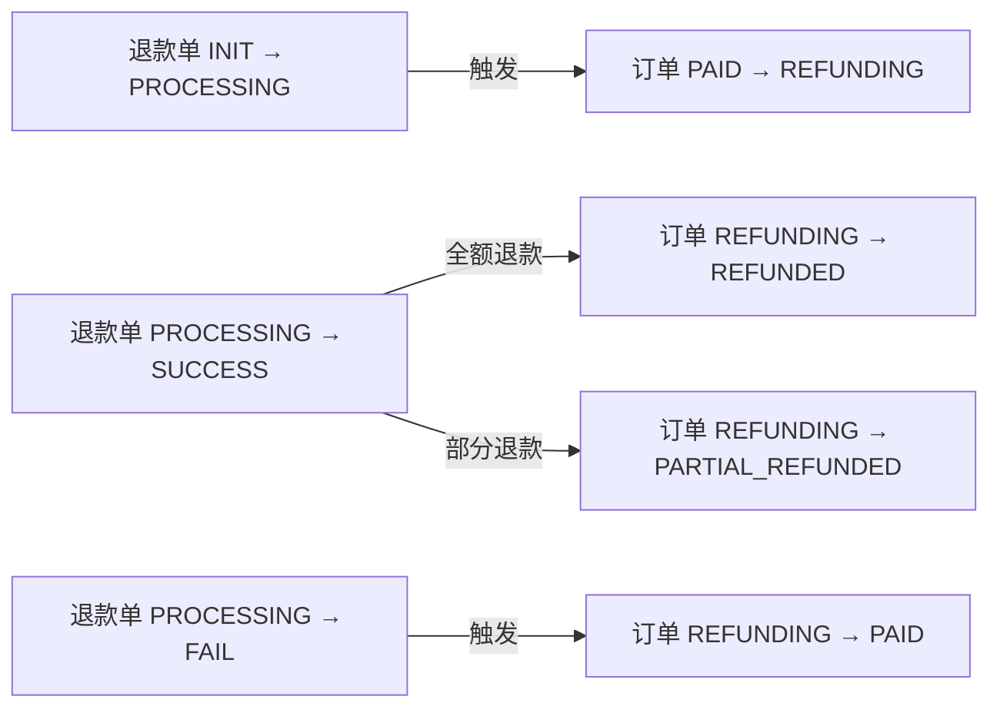

> **状态流转图要点**：
> - 每条转移的标注格式：`触发事件`
> - `[*]` 表示起始/终止伪状态，所有终态指向 `[*]`
> - 未在图中出现的 (当前状态, 触发事件) 组合视为**非法跳转**，运行时应拒绝并告警
> - 状态命名使用全大写下划线（与数据库字段枚举一致）
> - 涉及多个业务对象时，每个对象画独立的状态流转图，再用「状态联动图」（`flowchart`）描述对象间的触发关系

---

### 灰度方案示例（8.4）

**最小灰度闭环**：

- 小流量时长：10~30 分钟
- 必看指标：成功率、P99 延迟、关键错误码分布、MQ lag/堆积时长（如有）
- 放量条件：所有必看指标连续稳定 15 分钟，且无新增 P1 告警
- 回滚条件：成功率 < 99.9% / P99 > 500ms / MQ lag 持续增长超过 5 分钟 / 资金或核心业务差异 > 0
- 回滚动作：优先止血（关开关/切流量）→ 版本回退 → 数据补偿/修复 → 回滚校验

---

### 变更高亮示例（Mermaid 图表中标注新增/修改）

> 当方案涉及对已有流程/交互/状态的新增或修改时，使用红色背景高亮本次改动部分。

#### 流程图变更高亮示例（flowchart）

> 场景：已有支付流程中，新增「风控校验」和「异步通知」两个环节。

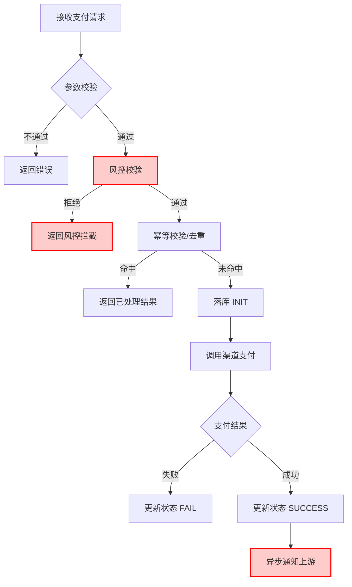

> 🔴 红色背景 = 本次新增/修改

#### 时序图变更高亮示例（sequenceDiagram）

> 场景：已有退款流程中，新增「记账服务」调用环节。

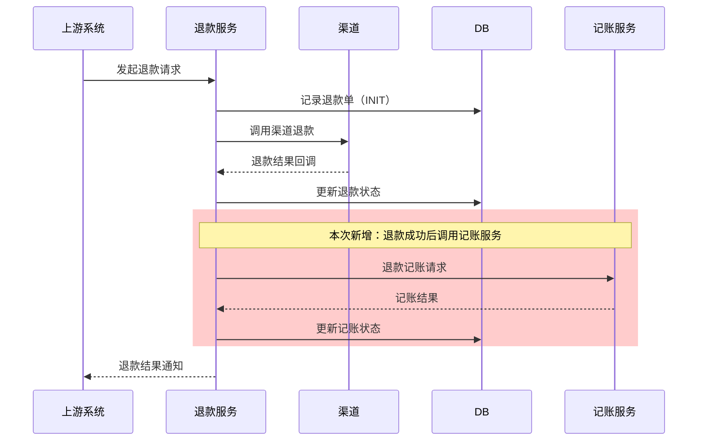

> 🔴 红色背景区域 = 本次新增/修改

#### 状态流转图变更高亮示例（stateDiagram-v2）

> 场景：已有退款单状态机中，新增「ACCOUNTING」记账中间态。

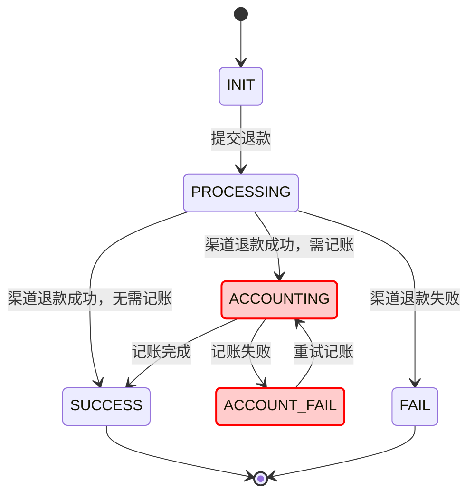

> 🔴 红色背景 = 本次新增/修改

#### 状态联动图变更高亮示例（flowchart）

> 场景：在已有退款联动基础上，新增记账状态联动。

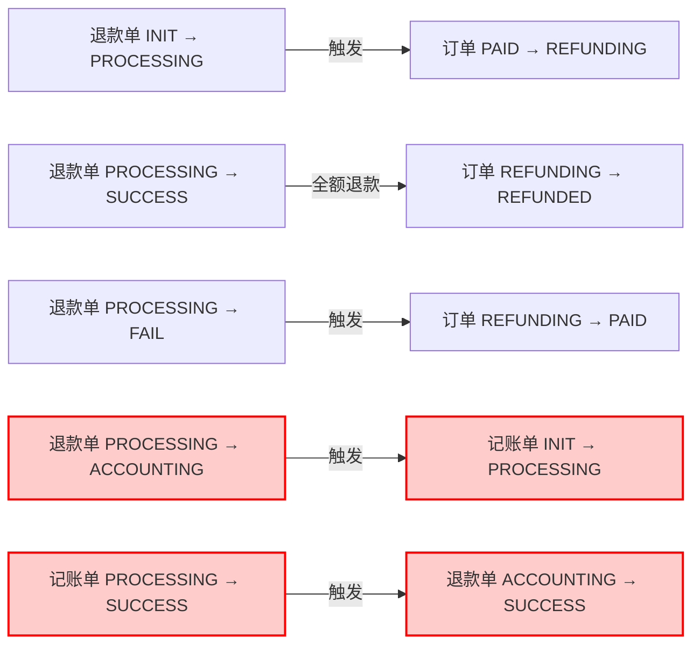

> 🔴 红色背景 = 本次新增/修改

---

> **变更高亮要点**：
> - `classDef highlight fill:#ffcccc,stroke:#ff0000,stroke-width:2px` — flowchart / stateDiagram 通用，在图开头定义一次
> - 节点标注：`节点ID[文字]:::highlight`（flowchart）或 `class 状态名 highlight`（stateDiagram，写在图末尾，不能加在 transition 行上）
> - `rect rgb(255, 204, 204)` ... `end` — sequenceDiagram 专用，包裹新增/修改的交互块
> - 每张图下方须有图例行：`> 🔴 红色背景 = 本次新增/修改`
> - **全新功能**（所有节点均为新增）不使用高亮，仅在二次开发/扩展场景下使用
